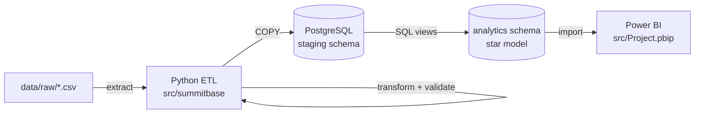

<div align="center">

  # 🚀 End-to-End Data Lifecycle & AI Integration

  

  [](https://kevinrn.com)
  [](https://linkedin.com/in/krobles-info)

  

  *A complete Data Engineering, Analytics, and Business Intelligence project showcasing a professional Agile workflow, automation, and AI integration.*

</div>

---

## 📖 About The Project

This repository demonstrates the **entire lifecycle of data**: from containerised infrastructure and a tested ETL pipeline to a SQL star schema and a Power BI dashboard, built the way a real-world corporate assignment would be.

### 🏔️ Business Case: SummitBase Outfitters

**SummitBase Outfitters** is a fictional e-commerce retailer of mountaineering, camping and outdoor gear. The synthetic dataset covers ~500k rows across 7 related tables:

| Table | Rows | Description |
|---|---:|---|
| `customers` | 26,000 | Profile, country, loyalty tier, marketing opt-in |
| `products` | 1,500 | Catalogue with price, cost and weight across 10 categories |
| `orders` | 90,000 | Order header: status, channel, subtotal, discount, tax, total (2024–2026) |
| `order_items` | 200,000 | Order lines: product, quantity, price |
| `payments` | 90,000 | One payment per order: method and status |
| `shipments` | 83,885 | Carrier, shipping and delivery dates |
| `returns` | 8,000 | Returned order lines: reason, refund, status |

**Business questions:** How are revenue and margin evolving? Which categories and channels drive profit? Who are our most valuable customers? Why do customers return products, and how fast do we deliver?

---

## 🏗️ Architecture



| Layer | What happens | Where |
|---|---|---|
| **Raw** | Immutable CSVs exactly as delivered | `data/raw/` |
| **Transform** | Typing, standardisation, missing-value handling | `src/summitbase/transform.py` |
| **Validate** | Primary/foreign keys, order math, date logic. The pipeline **stops** on any failure | `src/summitbase/validate.py` |
| **Staging** | Cleaned tables with enforced `PRIMARY KEY`, `FOREIGN KEY` and `CHECK` constraints | `sql/01_staging_schema.sql` |
| **Analytics** | Star schema: `dim_date`, `dim_customer`, `dim_product`, `fact_orders`, `fact_order_items`, `fact_returns` | `sql/02_analytics_views.sql` |
| **BI** | Power BI project (PBIP/TMDL) with DAX measures, version-controlled as text | `src/Project.SemanticModel/` |
| **Report** | 3 report pages + custom theme generated as code, sharing the slide decks' design | `tools/build_report.py` |

---

## ⚙️ Quick Start

**Requirements:** Docker Desktop, Python 3.11+, Power BI Desktop (Windows).

```powershell
# 1. Configure local credentials
Copy-Item .env.example .env

# 2. Start PostgreSQL
docker compose up -d

# 3. Install dependencies
python -m venv .venv
.venv\Scripts\pip install -r requirements-dev.txt

# 4. Run the pipeline (extract -> transform -> validate -> load)
$env:PYTHONPATH = "src"; .venv\Scripts\python -m summitbase
```

Then open `src/Project.pbip` in Power BI Desktop and click **Refresh**.
The connection uses the `PgServer` (`localhost:5432`) and `PgDatabase` (`summitbase`) parameters; enter the database user and password from your `.env` when prompted.

| Command | Purpose |
|---|---|
| `python -m summitbase --dry-run` | Clean and validate only, no database needed |
| `python -m summitbase --export` | Also write cleaned CSVs to `data/processed/` |
| `docker compose --profile tools up -d` | Also start pgAdmin at http://localhost:5050 |

---

## 📐 Business Definitions

Definitions live in one place (`sql/02_analytics_views.sql`) and are reused by every DAX measure:

| Concept | Rule |
|---|---|
| **Completed sale** | Order status is `processing`, `shipped` or `delivered` (payment captured) |
| **Net Revenue** | `total_amount` of completed sales |
| **Cancelled / Returned** | Status `cancelled` / `returned`, excluded from revenue |
| **Net Sales (line)** | `line_total` minus the order discount allocated proportionally to each line |
| **Gross Profit** | Net Sales − (quantity × unit cost) |
| **Customer cohort** | Month of the customer's first non-cancelled order |

**Data-cleaning decisions:** `phone` (33% missing) stays `NULL` and is exposed only as a `has_phone` flag. Missing `weight_kg` (5%) is imputed with the category median and flagged as `weight_imputed`. Email and phone are not exposed to the BI layer (PII minimisation).

---

## 🛠️ Technology Stack

| Category | Technologies |
| --- | --- |
| **Infrastructure & Setup** |  Docker &nbsp;&nbsp;  Git &nbsp;&nbsp;  PostgreSQL |
| **Data Processing & Python** |  Python &nbsp;&nbsp;  Pandas &nbsp;&nbsp;  Jupyter &nbsp;&nbsp;  Anaconda |
| **Automation & IDE** |  VS Code &nbsp;&nbsp;  n8n |
| **BI, UI/UX & AI** |  Power BI &nbsp;&nbsp;  Canva &nbsp;&nbsp; 🤖 AI LLMs |

---

## 📂 Repository Structure

```
├── data/raw/                 # Immutable synthetic source CSVs
├── sql/                      # Staging schema + analytics star schema
├── src/
│   ├── summitbase/           # Python ETL package (extract, transform, validate, load)
│   ├── Project.pbip          # Power BI project (open this file)
│   ├── Project.SemanticModel # TMDL model: tables, relationships, DAX measures
│   └── Project.Report        # Report pages + SummitBase theme (generated)
├── tools/build_report.py     # Generates the Power BI report and theme
├── docs/                     # Project plan and technical documentation
├── docker-compose.yml        # PostgreSQL (+ optional pgAdmin)
├── requirements*.txt         # Pinned Python dependencies
└── .env.example              # Credential template (copy to .env)
```

---

## 🗺️ Roadmap

| Status | Phase |
|---|---|
| ✅ | Infrastructure: Docker + PostgreSQL, reproducible environment, secrets kept out of Git |
| ✅ | ETL pipeline with data-quality gates and a constrained staging layer |
| ✅ | SQL star schema and Power BI semantic model with DAX measures |
| ✅ | Power BI report pages (Summary, Customers & Returns, Operations) with a custom theme |
| ⏳ | Exploratory analysis notebooks: RFM segmentation, cohorts, returns |
| ⏳ | Unit tests (pytest) and CI with GitHub Actions |
| ⏳ | n8n workflow for scheduled data refresh |
| ⏳ | Scrum board, sprint documentation and Canva stakeholder presentation |
| ⏳ | AI integration: LLM-generated executive summary from the KPIs |

---

## 🤝 Let's Connect!

I am always looking for new challenges and opportunities in the Data world. If you are a recruiter or a fellow data enthusiast, feel free to reach out!

- 🌐 **Portfolio:** [Kevinrn.com](https://kevinrn.com)
- ✉️ **Email:** krobles.info@gmail.com
- 💼 **LinkedIn:** [linkedin.com/in/krobles-info](https://www.linkedin.com/in/krobles-info)

> **Note to recruiters:** This project was built to demonstrate not just technical coding skills, but also project management, automation, UX/UI, and adaptability to modern AI tools. Thank you for visiting!


